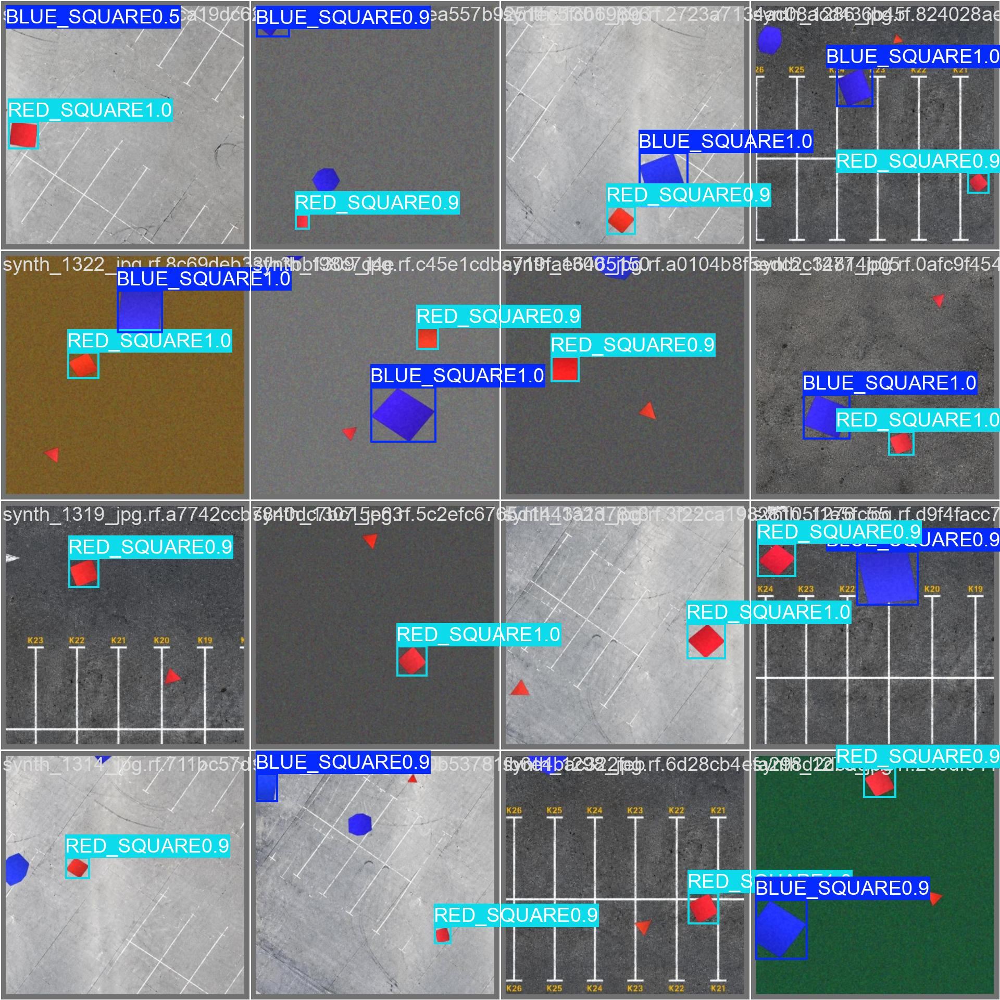
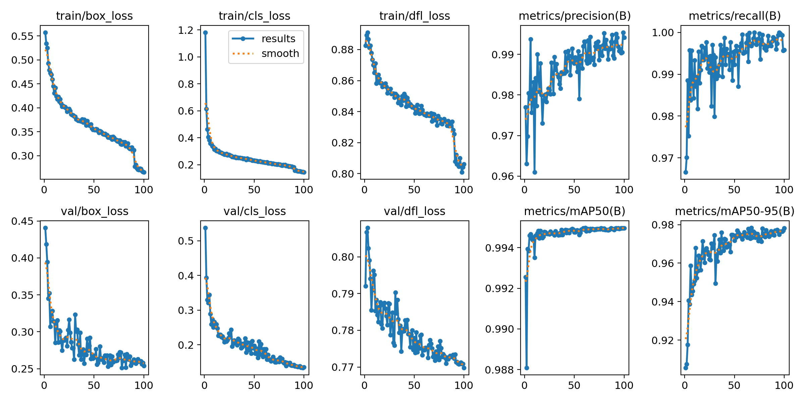
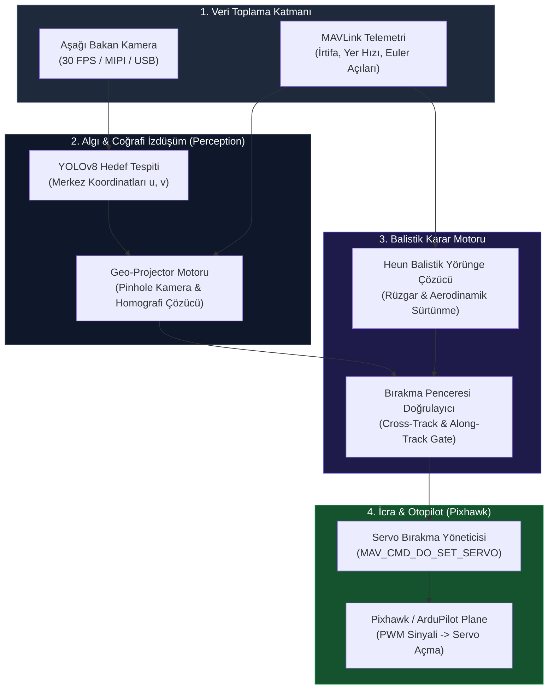

# TEKNOFEST Sabit Kanat İHA - Otonom Görev İcra & Balistik Yük Bırakma Sistemi
### (Scandium Autonomous Avionics & Ballistic Targeting Engine)

[](https://www.python.org/)
[](https://github.com/ultralytics/ultralytics)
[](https://pytorch.org/)
[](https://ardupilot.org/)
[](https://mavlink.io/)
[](https://gazebosim.org/)
[](LICENSE)

---

## 🎯 Proje Özeti (Executive Summary)

Bu proje, **TEKNOFEST Uluslararası İHA ve Savaşan İHA Yarışmaları (Sabit Kanat Kategorisi)** için özel olarak geliştirilmiş; görev bilgisayarı (Raspberry Pi / NVIDIA Jetson) ile otopilot (Pixhawk / ArduPilot) arasında tam otonom çalışan, yapay zeka destekli hedef tespit, coğrafi izdüşüm (geo-projection) ve sayısal balistik yük bırakma sistemidir.

Sistem, uçağın altındaki kameradan gelen canlı görüntüleri derin öğrenme tabanlı nesne tespit modelleri ile işler, uçağın telemetri verilerini (irtifa, hız, yalpalama, rüzgar yönü) gerçek zamanlı analiz eder ve serbest düşüş dinamiğini matematiksel olarak modelleyerek hedefi milimetrik hassasiyetle vurur.

---

## 📊 Performans ve Doğrulama Metrikleri

Eğitilen özel YOLOv8 modeli, sahada hakemlerin yanıltmak için yerleştirdiği sahte hedefleri (altıgen ve üçgen) tamamen ayırt edebilmek amacıyla **Hard-Negative Mining** yaklaşımıyla eğitilmiştir.

| Metrik | Değer | Açıklama |
| :--- | :--- | :--- |
| **mAP@50 (Precision-Recall)** | **%99.5** (0.995) | Kırmızı ve mavi kare hedeflerin kusursuz tanınması |
| **mAP@50-95** | **%97.7** (0.977) | Yüksek örtüşme (IoU) toleransında kesin merkez tespiti |
| **Çıkarım (Inference) Süresi**| **2.8 ms / kare** | NVIDIA GPU / TensorRT ile 300+ FPS gerçek zamanlı işleme |
| **Dinamik Güven Eşiği** | **%75 (0.75)** | Sahte hedeflerin (üçgen/altıgen) %0 yanlış alarm ile elenmesi |
| **Gecikme Telafisi (Latency)**| **< 15 ms** | Kamera pozlama anı ile MAVLink zaman damgası eşitlemesi |

<p align="center">
  
  
</p>

<p align="center">
  <em>Sol: YOLOv8 modelinin farklı zemin ve perspektiflerde hedef tespit çıktıları. Sağ: 100 epoch boyunca mAP ve Loss eğrileri.</em>
</p>

---

## 🚀 Temel Yetenekler & İnovasyonlar (Key Innovations)

### 1. Hard-Negative Mining Destekli Sentetik Veri Motoru
Standart elle etiketlenmiş sınırlı veri setleri yerine, `generate_synthetic_data.py` motoru ile yarışma çim/asfalt dokuları üzerine 3 boyutlu rotasyon, gölge ve rüzgar simülasyonları eklenerek binlerce sentetik veri üretilmiştir. Hakemlerin koyacağı üçgen ve altıgen geometrileri modele etiketlenmeden negatif sınıf olarak tanıtılmış, böylece model sahte hedefleri çimden farksız arka plan kabul etmeyi öğrenmiştir.

### 2. Heun Sayısal Balistik Entegrasyon Motoru
Hedefin tam üstüne gelindiğinde kapak açılırsa, uçağın 60-70 km/h ileri hızı nedeniyle bomba hedefi metrelerce ıskalar. Sistemimizde doğrusal olmayan aerodinamik sürüklenme hesaba katılmıştır:

$$\mathbf{F}_d = -\frac{1}{2} \rho C_d A \|\mathbf{v}\| \mathbf{v}$$

2. Derece Runge-Kutta (Heun Yöntemi) kullanılarak, yer hızı ve bağıl irtifadan yükün yere temas edeceği parabol saniyenin yüzde birinde hesaplanır. İHA hedefin önüne yaklaşırken balistik kilitlenme sağlanır ve bırakma emri tam zamanında verilir.

### 3. Zaman Damgalı Gecikme Telafisi (Latency Compensation)
Kameradan karenin okunması, YOLO çıkarımı ve MAVLink hattından komutun Pixhawk'a iletilmesi arasındaki 80-150 ms'lik gecikme sırasında uçak 2-3 metre yer değiştirir. Scandium mimarisi, her görüntü karesini kameranın yakalandığı andaki AHRS/IMU telemetrisiyle eşleştiren dairesel zaman damgası tamponu (timestamp ring buffer) kullanarak bu kaymayı sıfırlar.

---

## 🏗️ Görevler ve Sistem Mimarisi



### 📍 Görev 1: Otonom Seyrüsefer & Dinamik Waypoint Üretimi (`mission_1/`)
- Şartnamedeki direk koordinatlarını baz alarak rüzgar açısına en uygun kalkış ve dönüş rotasını dinamik olarak planlar.
- ArduPilot uyumlu `.waypoints` ve Google Earth / QGroundControl uyumlu `.kml` dosyalarını matematiksel olarak üretir.
- Otonom kalkış ve iniş katsayılarını (1.0 tam puan) hedefleyen yumuşak geçişli teğet dönüş eğrileri oluşturur.

### 🎯 Görev 2: Hedef Tespiti & Balistik Yük Bırakma (`mission_2/`)
- **Yapay Zeka:** YOLOv8 nano/small mimarisi ile kırmızı ve mavi kare hedeflerin merkezini çıkarır.
- **Geo-Projection:** Kamera iç parametreleri, montaj eğim açısı (pitch/roll ofsetleri) ve uçağın anlık tutumu ile piksel koordinatını yer koordinatına çevirir.
- **Kritik Tetikleme:** `demo_pipeline.py` üzerinden PyMAVLink ile Pixhawk'a `COMMAND_LONG` paketi fırlatarak yük bırakma mekanizmasını harekete geçirir.

### 🧪 Simülasyon & Sanal Test Ortamı (`simulation/`)
- **Gazebo Harmonic & SITL Entegrasyonu:** Gerçek uçuş riskini ortadan kaldıran sanal rüzgar, hedef sahası ve uçak aerodinamiği simülatörü.
- Cessna ve Skywalker / Techpod İHA 3D modelleri, kamera eklentileri ve ArduPlane SITL köprüleri.

---

## 📁 Dizin Yapısı (Repository Structure)

```text
├── docs/                 # TEKNOFEST 2026 İHA Şartnamesi, şemalar ve görsel varlıklar
│   ├── assets/           # Eğitim grafikleri, tespit örnekleri ve mimari şemalar
│   └── TEKNOFEST_2026_IHA_Sartnamesi.pdf
├── mission_1/            # 1. Görev: Otonom seyrüsefer ve rota oluşturucu
│   ├── generate_mission1.py
│   └── gorev1_ruzgar_A.waypoints
├── mission_2/            # 2. Görev: Hedef tespiti, geo-projection ve balistik bırakma
│   ├── configs/          # Uçuş, kamera kalibrasyon ve bırakma tolerans ayarları
│   ├── scripts/          # Ana çalışma scriptleri
│   │   ├── demo_pipeline.py           # Canlı uçuş / test ana kontrol döngüsü
│   │   ├── train_yolov8.py            # YOLOv8 model eğitim scripti
│   │   ├── generate_synthetic_data.py # Sentetik veri üretim motoru
│   │   ├── webcam_test.py             # Canlı kamera doğrulama testi
│   │   └── debug_tools/               # Geliştirme ve teşhis araçları
│   ├── src/              # Scandium çekirdek kütüphaneleri (perception, ballistics, mavlink)
│   └── ai_training/      # Eğitilmiş model ağırlıkları (best.pt) ve sonuç logları
├── simulation/           # ArduPilot SITL ve Gazebo simülasyon ortamı
│   ├── models/           # İHA gövde ve sensör SDF/DAE modelleri
│   ├── scripts/          # Simülasyon başlatıcı kabuk scriptleri
│   ├── setup/            # Gazebo Harmonic kurulum otomasyonu
│   └── tools/            # Simülasyon yardımcı yamaları
└── README.md             # Proje dokümantasyonu
```

---

## 🛠️ Kurulum & Çalıştırma (Quick Start)

### 1. Gereksinimler
- Python 3.11+
- CUDA destekli GPU (NVIDIA RTX veya Jetson)
- PyTorch 2.0+, OpenCV, Ultralytics, PyMAVLink

### 2. Klonlama ve Paket Kurulumu
```bash
git clone https://github.com/emrealtindag/fixedwing-ballistic-drop.git
cd fixedwing-ballistic-drop

# Gerekli bağımlılıkları yükleyin
pip install -r mission_2/requirements.txt
```

### 3. Modelin Canlı Kamerada Test Edilmesi
```bash
python mission_2/scripts/webcam_test.py
```

### 4. Tam Görev Pipeline'ının Başlatılması
```bash
# Simülasyon veya gerçek Pixhawk bağlantısı ile hedef takip ve bırakma döngüsü
python mission_2/scripts/demo_pipeline.py --config mission_2/configs/mission2_fixedwing.yaml
```

---

## 👥 Geliştirici & Takım Bilgisi

- **Yazılım & Aviyonik Mimarisi:** [Emre Altındağ](https://github.com/emrealtindag)
- **Kategori:** TEKNOFEST Sabit Kanat İHA / Otonom Aviyonik Sistemleri
- **Lisans:** [Apache License 2.0](LICENSE)
