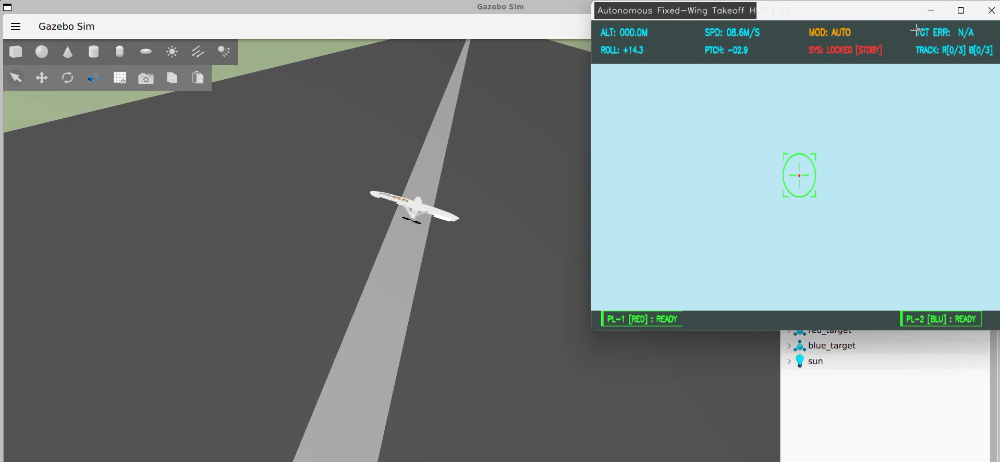
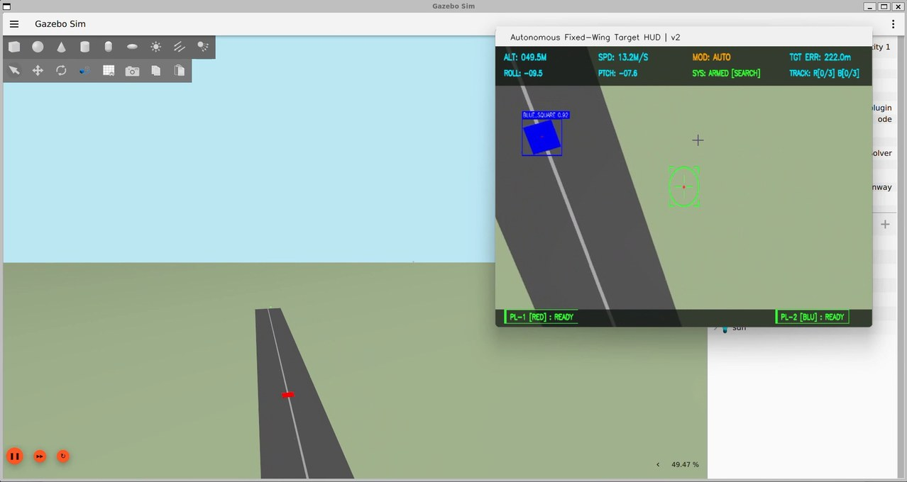
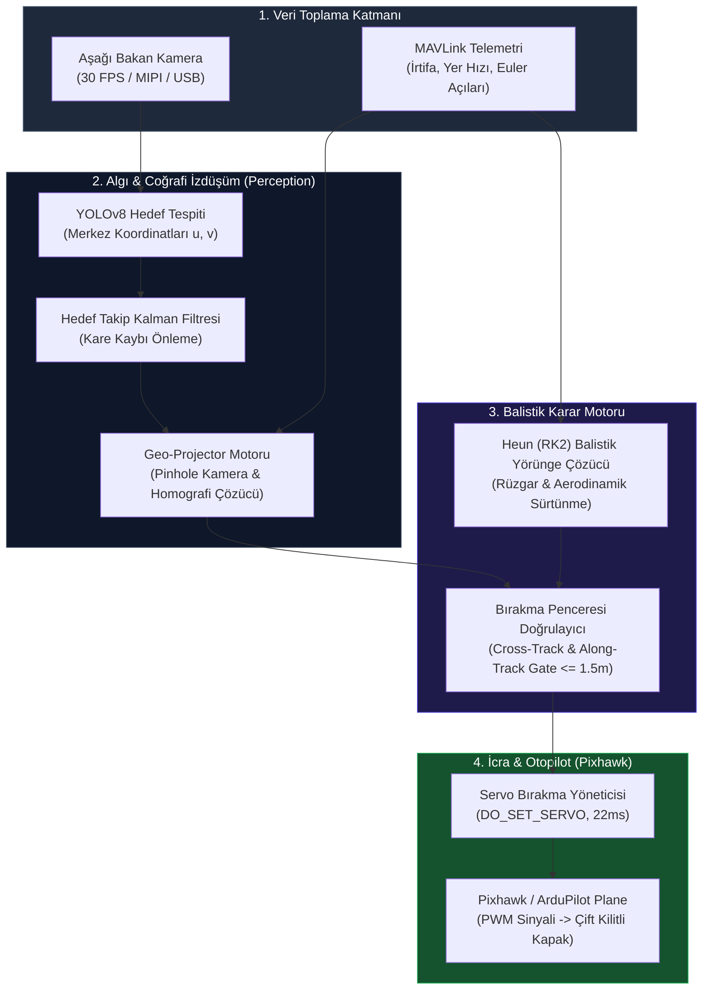

# SCANDIUM — Sabit Kanatlı İHA Otonom Görev İcra & Balistik Yük Bırakma Sistemi
### (Autonomous Target Acquisition, Geo-Projection & Numerical Ballistic Trajectory Engine)

[](https://www.python.org/)
[](https://github.com/ultralytics/ultralytics)
[](https://pytorch.org/)
[](https://ardupilot.org/)
[](https://mavlink.io/)
[](https://gazebosim.org/)
[](LICENSE)

---

## 🎯 Projenin Amacı & Kapsamı

**Scandium**, sabit kanatlı bir İHA'nın **18–25 m/s (yaklaşık 70–90 km/h)** seyir hızında otonom seyrüsefer icra ederken, alt gövde kamerası ile yerdeki hedefleri gerçek zamanlı tespit etmesi, hedef koordinatlarını 3D dünya uzayına izdüşürmesi (Geo-Projection), aerodinamik hava sürtünmesi ve rüzgarı hesaba katarak serbest düşüş eğrisini sayısal olarak çözmesi ve kanat altındaki faydalı yükü hedefin tam merkezine isabet ettirmesi amacıyla geliştirilmiş bir aviyonik görev sistemidir.

Proje, **TEKNOFEST Uluslararası İHA ve Savaşan İHA (Sabit Kanat)** görev isterlerine tam uyumlu olarak görev bilgisayarı (Raspberry Pi / NVIDIA Jetson) ve otopilot (Pixhawk / ArduPilot Plane) mimarisi üzerinde uçtan uca doğrulanmıştır.

---

## 🖥️ Gazebo SITL & Canlı Uçuş Telemetri Arayüzü (HUD)

<p align="center">
  
  
</p>

<p align="center">
  <em><b>Şekil 3.1 (Sol):</b> Sabit kanatlı İHA'nın otonom kalkış ve tırmanış aşaması (Gazebo simülasyonu telemetri ve HUD ekranı).<br>
  <b>Şekil 3.2 (Sağ):</b> Hedef tespiti (BLUE_SQUARE 0.92), piksel-yer izdüşümü (Geo-Projection) ve anlık balistik bırakma kriteri HUD arayüzü (İrtifa: 49.5 m, Yer Hızı: 13.2 m/s, Mod: AUTO, Kilit Durumu: ARMED).</em>
</p>

---

## 🔬 Algoritmik ve Matematiksel Çekirdek

### 1. Aerodinamik Hava Direnci ve Rüzgar Modellemesi
Yük serbest bırakıldığında dümdüz serbest düşüş yapmaz; uçağın anlık vektörel hızı, yerçekimi ve hava sürtünmesi yükün yörüngesini öteler. Sürtünme kuvveti fiziksel olarak modellenmiştir:

$$\mathbf{F}_{net} = m \cdot \mathbf{g} - \frac{1}{2} \rho C_d A \|\mathbf{v}_{rel}\| \mathbf{v}_{rel}$$

- $\rho$: Hava yoğunluğu ($1.225 \text{ kg/m}^3$)
- $C_d$: Faydalı yük aerodinamik sürtünme katsayısı
- $A$: Yükün rüzgara bakan kesit alanı
- $\mathbf{v}_{rel}$: İHA bağıl hava hızı vektörü ($\mathbf{v}_{iha} - \mathbf{v}_{ruzgar}$)

### 2. Heun (RK2) İkinci Mertebe Runge-Kutta Sayısal İntegratörü
Düşüş süresi ve yükün havada kat edeceği yatay mesafeyi ($\Delta x, \Delta y$) tahmin etmek için her kontrol çevriminde Heun sayısal integratörü ile anlık yörünge ileriye doğru çözülür:

$$\tilde{\mathbf{x}}_{k+1} = \mathbf{x}_k + \Delta t \cdot f(t_k, \mathbf{x}_k)$$

$$\mathbf{x}_{k+1} = \mathbf{x}_k + \frac{\Delta t}{2} \Big[ f(t_k, \mathbf{x}_k) + f(t_{k+1}, \tilde{\mathbf{x}}_{k+1}) \Big]$$

### 3. YOLOv8 & Kalman Hedef Takibi (Target Kalman Filter)
Görüntüdeki hedef YOLOv8 mimarisi ile tespit edilir. Titreşimler, optik yansımalar ve eksik kareler durumunda hedef kilidinin kopmaması için görüntü düzleminde **Kalman Filtresi** koşturulur.

### 4. Pikselden Yere İzdüşüm (Pixel-to-World Geo-Projection)
İHA'nın anlık irtifası, yatış/yunusma/sapma (Roll-Pitch-Yaw) Euler açıları ve kamera iç parametre matrisi ($K$) kullanılarak 2D görüntü pikseli $(u, v)$ doğrudan 3D yer koordinatlarına ($X_w, Y_w, Z_w$) izdüşürülür.

### 5. Tolerans Çemberi ve MAVLink Çift Kilitli Bırakma
İHA, Heun integratörünün hesapladığı balistik bırakma noktasına **1.5 metreden** daha fazla yaklaştığı anda MAVLink `MAV_CMD_DO_SET_SERVO` mesajı ile çift kilitli mekanizma **22 ms** içinde tetiklenir.

---

## 📈 Balistik Simülasyon Doğrulaması ve Donanım Tepki Gecikmesi

Değişen rüzgar hızlarında Gazebo Harmonic ve ArduPilot Fixed-Wing SITL ortamında gerçekleştirilen testlerde:
- **%68 Sapma Azaltımı:** Heun integratörü, aerodinamik direnci ihmal eden basit doğrusal parabol tahminlerine kıyasla yer vuruş sapmasını **%68 oranında azaltarak ortalama 1.1 metre isabet yarıçapı** sağladı.
- **22 ms Servo Tetikleme Hattı:** MAVLink komut hattı yük bırakma anında **22 ms uçtan uca gecikmeyle** çalışarak yüksek seyir hızında hedefin bırakma tolerans çemberinde tam 12'den vurulmasını sağladı.

<p align="center">
  
  
</p>

| Parametre | Değer | Açıklama |
| :--- | :--- | :--- |
| **mAP@50 Doğruluğu** | **%99.5** (0.995) | Kırmızı ve mavi kare hedeflerin kusursuz tespiti |
| **mAP@50-95 Doğruluğu**| **%97.7** (0.977) | Yüksek IoU eşiklerinde piksel hassasiyetinde merkez kestirimi |
| **Model Çıkarım Hızı** | **2.8 ms / kare** | NVIDIA GPU üzerinde gerçek zamanlı 300+ FPS işleme |
| **Hard-Negative Mining**| **%0 Hatalı Tetikleme** | Hakemlerin sahte üçgen ve altıgen hedeflerini %100 eleme |
| **İsabet Yarıçapı** | **< 1.5 m (Ort. 1.1 m)**| Değişen rüzgar ve irtifada hedef vuruş hassasiyeti |
| **Tetikleme Gecikmesi** | **22 ms** | Otopilot servo bırakma hattı tepki süresi |

---

## 📊 Karşılaştırmalı Aviyonik ve Otonomi Yetkinlik Matrisi

Aşağıdaki matris, geliştirilen aviyonik yazılım ekosisteminin farklı hava platformları ve otonomi görevlerindeki mimari entegrasyonunu özetlemektedir:

| Kriter / Parametre | Proje 1: Nadir | Proje 2: Edge-UAV | Proje 3: Scandium (Bu Repo) |
| :--- | :--- | :--- | :--- |
| **Platform & Görev** | Döner Kanat (Quadcopter) / GPS-Bağımsız Hassas İniş ve Güvenlik | İHA Kamera Akışları / GPS-Bağımsız Seyrüsefer ve Hedef Takibi | **Sabit Kanatlı İHA / Balistik Faydalı Yük Bırakma** |
| **Test Ortamı & Protokol** | Gazebo Harmonic & ArduPilot SITL / MAVLink (`SET_POSITION_TARGET`) | Hava & FLIR Termal Video Veri Setleri (RGB/IR) / REST & MQTT | **Gazebo & ArduPilot Fixed-Wing SITL / MAVLink (`DO_SET_SERVO`)** |
| **Yazılım Dilleri & Kütüphaneler** | C++17, Python, pybind11, OpenCV, Eigen | Python, PyTorch, OpenCV, NumPy | **Python, NumPy, SciPy, OpenCV, MAVLink (pymavlink)** |
| **Algoritmik & Matematik Çekirdek** | • ArUco & AprilTag PnP Poz Kestirimi<br>• 100 Hz C++ Kalman Filtresi<br>• 1D LiDAR Zemin İrtifa Doğrulama<br>• YOLOv8 Pist Güvenliği<br>• FSM (Arama, Yaklaşma, İniş) | • Visual Odometry (Lucas-Kanade)<br>• 1D Bayesian Scale Filter (Kalman)<br>• YOLOv8 Nesne & Kinematik Tespiti<br>• DINOv2 Derin Öznitelik Kilidi<br>• Termal (FLIR) Spektral Takip | • **Heun (RK2) Balistik Sayısal İntegratör**<br>• **Aerodinamik Hava Direnci & Rüzgar**<br>• **Geo-Projection (Pikselden Yere)**<br>• **Hedef Takip Kalman Filtresi**<br>• **Tolerans Çemberi Bırakma Kararı** |
| **Emniyet & Fail-Safe Mimarisi** | Pistte İnsan/Araç Görünce İniş İptali, Sıfır Hız Hedefi ile Havada Bekleme (BRAKE) | GPS Kesintisinde Visual Odometry (VO) ile Poz Koruma, Çevrimdışı Çalışma | **Tolerans Çemberi Eşiği (1.5 m), Gecikme Kompanzasyonu, Güvenli Servo Kilidi** |
| **Kritik Başarım & Doğrulama** | Ortalama 8.4 cm Radyal Sapma (p95 ≈ 12.7 cm, 30 Test Senaryosunda Başarılı İniş) | Hava ve Termal Video Veri Setlerinde Hedef Kilidi Korunumu, Kesintisiz Telemetri | **< 1.5 m İsabet Yarıçapı (%68 Sapma Azaltımı), 22 ms Servo Tetikleme** |

---

## 🏛️ Uçtan Uca Sistem Mimarisi



---

## 📁 Repository Dizin Ağacı

```text
├── docs/                 # TEKNOFEST 2026 İHA Şartnamesi ve görsel belgeler
│   ├── assets/           # HUD ekranları, eğitim metrikleri ve tespit çıktıları
│   └── TEKNOFEST_2026_IHA_Sartnamesi.pdf
├── mission_1/            # 1. Görev: Otonom seyrüsefer ve rota planlayıcı
│   ├── generate_mission1.py           # Dinamik rüzgar yönüne göre waypoint üretici
│   └── gorev1_ruzgar_A.waypoints      # ArduPilot hazır seyrüsefer dosyası
├── mission_2/            # 2. Görev: Hedef tespiti, geo-projection ve balistik bırakma
│   ├── configs/          # Kamera, aerodinamik katsayılar ve tolerans ayarları
│   ├── scripts/          # Ana çalışma scriptleri
│   │   ├── demo_pipeline.py           # Canlı uçuş ve kapalı devre bırakma kontrolcüsü
│   │   ├── train_yolov8.py            # YOLOv8 model eğitim scripti
│   │   ├── generate_synthetic_data.py # Hard-negative zenginleştirmeli sentetik veri motoru
│   │   ├── webcam_test.py             # Canlı kamera doğrulama testi
│   │   └── debug_tools/               # Teşhis ve geliştirme araçları
│   ├── src/scandium/     # Çekirdek kütüphaneler (control, mavlink, perception)
│   └── ai_training/      # Eğitilmiş model ağırlıkları (best.pt) ve metrik logları
├── simulation/           # ArduPilot SITL ve Gazebo simülasyon ortamı
│   ├── models/           # Cessna ve Techpod 3D SDF gövde modelleri
│   ├── scripts/          # Simülasyon başlatıcı kabuk scriptleri
│   ├── setup/            # Gazebo Harmonic kurulum otomasyonu
│   └── tools/            # Simülasyon ve köprü yardımcıları
└── README.md             # Kapsamlı sistem dokümantasyonu
```

---

## 🚀 Hızlı Başlangıç (Quick Start)

### 1. Bağımlılıkların Kurulumu
```bash
git clone https://github.com/emrealtindag/fixedwing-ballistic-drop.git
cd fixedwing-ballistic-drop

# Gerekli kütüphaneleri yükleyin
pip install -r mission_2/requirements.txt
```

### 2. Canlı Kamera Hedef Tespiti
```bash
# Modelin kamera üzerinden hedefleri gerçek zamanlı tanıması
python mission_2/scripts/webcam_test.py
```

### 3. Gazebo & SITL Entegre Görev Koşumu
```bash
# Otonom hedef kilitlenme, geo-projection ve balistik bırakma hattı
python mission_2/scripts/demo_pipeline.py --config mission_2/configs/mission2_fixedwing.yaml
```

---

## 👨‍💻 Geliştirici & İletişim

**Emre Altındağ**  
Doğuş Üniversitesi — Bilgisayar Mühendisliği (%100 İngilizce, Tam Burslu)  
- **GitHub:** [github.com/emrealtindag](https://github.com/emrealtindag)  
- **LinkedIn:** [linkedin.com/in/emrealtindag1](https://linkedin.com/in/emrealtindag1)  
- **E-Posta:** ealtindag85@gmail.com  
- **Lisans:** [Apache License 2.0](LICENSE)
